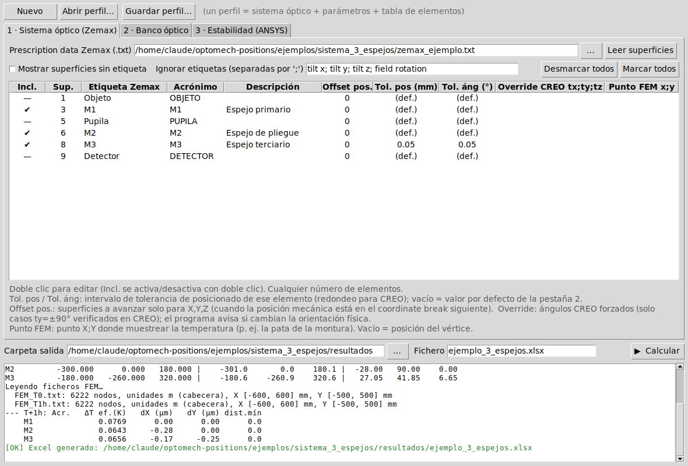
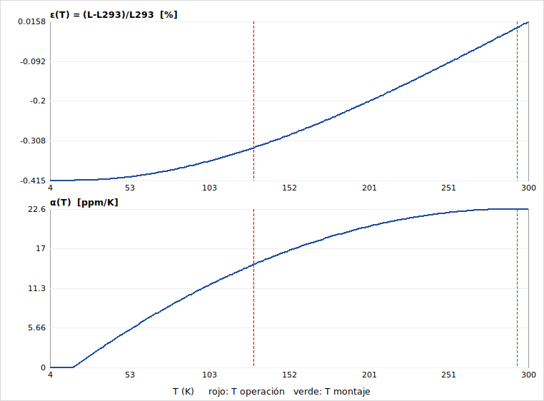

# optomech-positions

Herramienta para pasar las posiciones de un sistema óptico diseñado en **Zemax OpticStudio** (en frío) a posiciones de montaje en **CREO** (en caliente), y para estudiar la **estabilidad térmica** del banco óptico a partir de resultados de temperatura de **ANSYS**.

*Converts Zemax global surface coordinates (cold) into CREO assembly positions (warm), with per-element positioning tolerances, NIST thermal-expansion curves and a first-order thermal-stability study from ANSYS temperature results.*



## Qué hace

- Lee el *Prescription Data* de Zemax (sección `GLOBAL VERTEX COORDINATES`) de cualquier sistema y lista las superficies etiquetadas.
- Convierte la orientación de cada superficie de la convención de Zemax a ángulos CREO, incluido el caso de *gimbal lock* (ty = ±90°).
- Aplica la contracción térmica desde un punto fijo del banco y redondea cada elemento a su propia tolerancia de posicionado. Calcula el *back-calc* a frío y el residuo que introduce el redondeo.
- Obtiene el factor térmico y el CTE a partir de curvas de dilatación (polinomios NIST o tablas propias) o de un valor introducido a mano.
- Estudio de estabilidad: compara un fichero de temperaturas ANSYS de referencia (T0) con uno o varios casos y calcula el desplazamiento X-Y de cada elemento, en ejes globales y en los ejes locales de la superficie.
- Genera un Excel con las pestañas: Parámetros, Posiciones CREO, Zemax global, Estab \<caso\> y Avisos.
- Cada sistema óptico se guarda como un perfil `.json` portable, con rutas relativas al perfil.

## Instalación

Requiere Python 3.9 o superior. La interfaz usa `tkinter`, que viene incluido en Python de python.org.

```bash
git clone https://github.com/elviohs/optomech-positions.git
cd optomech-positions
pip install -r requirements.txt
```

## Uso

**Interfaz gráfica.** En Windows, doble clic en `lanzar_gui.bat`; también se puede arrastrar un perfil `.json` encima del .bat. En cualquier sistema:

```bash
python gui.py [perfil.json]
```

**Sin interfaz**, útil para automatizar:

```bash
python cli.py ejemplos/sistema_3_espejos/ejemplo_3_espejos.json
```

### Dar de alta un sistema nuevo

1. **Zemax.** Exporta *Analyze → Reports → Prescription Data* con las coordenadas globales activadas. Etiqueta (campo *Comment*) cada superficie que sea un elemento mecánico. Elige como superficie de referencia global la que coincida con el origen del modelo CREO.
2. **Pestaña 1.** Carga el `.txt` y marca los elementos. Para cada uno puedes indicar:
   - Acrónimo y descripción.
   - Tolerancia de posición y angular. Si se dejan vacías, se usan las de la pestaña 2.
   - *Offset* de posición: cuando la posición mecánica está en el *coordinate break* siguiente a la superficie.
   - *Override* de ángulos CREO: solo para casos de gimbal lock ya fijados en CREO. El programa avisa si el override cambia la orientación física.
   - Punto de muestreo FEM.
3. **Pestaña 2.** Temperaturas de operación y de montaje, material o CTE, punto fijo del banco y tolerancias por defecto.
4. **Pestaña 3** (opcional). Fichero ANSYS de referencia T0 y los casos a estudiar.
5. **Guardar perfil** y **Calcular**. Revisa siempre la pestaña *Avisos* del Excel.

### Formato de los ficheros ANSYS

Texto delimitado por tabuladores, punto y coma o espacios, con decimal coma o punto:

```
Node Number   X Location (m)   Y Location (m)   Z Location (m)   Temperature (K)
```

Las unidades (m o mm) se leen de la cabecera. Si la cabecera no cuadra con la extensión de la malla, el programa avisa y corrige.

## Convenciones

| | |
|---|---|
| Zemax | R = Rx(tx)·Ry(ty)·Rz(tz); las columnas de R son los ejes locales |
| CREO | R = Rz(tz)·Ry(ty)·Rx(tx) → ty = asin(−R₂₀), tx = atan2(R₂₁, R₂₂), tz = atan2(R₁₀, R₀₀) |
| Gimbal lock | tz = 0, tx = atan2(±R₀₁, ±R₀₂) |
| Térmica | P_caliente = P_fijo + (P_frío − P_fijo)·(1 + f), con f = (1 + ε(T_cal)) / (1 + ε(T_frío)) − 1 |
| Redondeo | Mitad hacia fuera, como la función ROUND de Excel |

## Materiales

El fichero `materiales.json` contiene las curvas de dilatación lineal de NIST, *Cryogenic Material Properties*, para Al 6061-T6 y para los aceros AISI 304, 304L y 316. Los coeficientes se han comprobado contra las tablas de NIST.



Para añadir un material, copia los coeficientes de la tabla *Linear Expansion* de NIST (a…e, T_low, f) o una tabla T / ΔL/L de otra fuente. Pon `"verificado": true` solo después de comprobarlos contra la fuente original.

## Limitaciones

- La estabilidad es un modelo de primer orden en X-Y: el banco se deforma libremente desde un punto fijo y el ΔT se promedia a lo largo de la trayectoria entre el punto fijo y el elemento.
- No calcula tilts ni desplazamientos en Z. Para eso hay que usar los desplazamientos de un análisis termo-estructural.
- Supone un único banco de un solo material.
- Los ficheros Zemax con multiconfiguración deben exportarse una configuración cada vez.

## Tests

```bash
pip install pytest
pytest
```

Se ejecutan automáticamente en GitHub Actions en cada *push*.

## Estructura

```
core.py            motor de cálculo (sin interfaz)
materials.py       curvas de dilatación ε(T), α(T)
excel_out.py       generación del Excel
gui.py             interfaz tkinter
cli.py             ejecución por línea de comandos
materiales.json    base de materiales
ejemplos/          sistema sintético de 3 espejos (Zemax + ANSYS)
tests/             pruebas automáticas
```

El ejemplo es sintético y no corresponde a ningún instrumento real.

## Autoría y uso de IA

Desarrollado en el Departamento de Ingeniería Mecánica del Instituto de Astrofísica de Canarias (IAC). Parte del código se escribió con ayuda de un asistente de IA (Claude, de Anthropic). Los resultados se revisaron y validaron contra las herramientas de conversión del departamento y contra datos de NIST.
